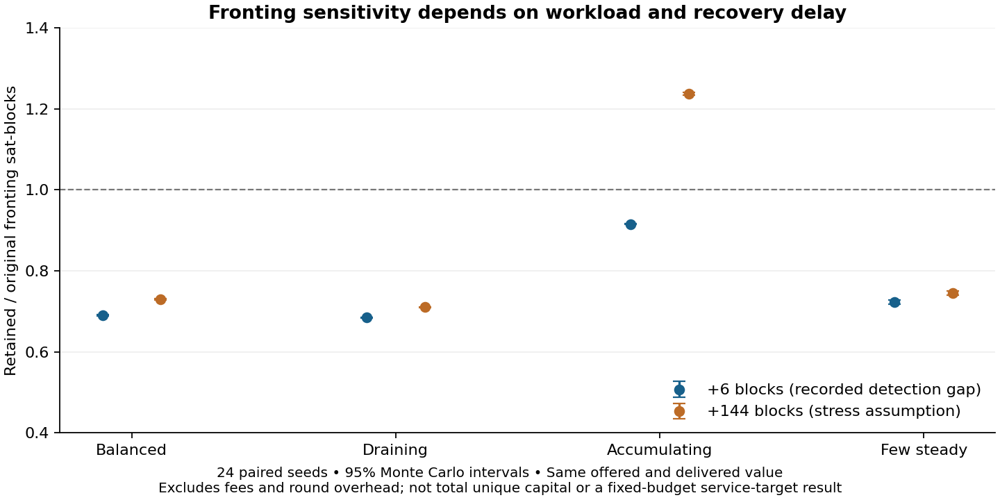

# Retained-backing structural sensitivity

Evidence class: implementation-informed, fee-free forecast. This is a completed paired sensitivity, **not the final fixed-budget capital-efficiency comparison**.

The 34-event regtest reconstruction establishes retained payment change and recovery after an original-board sweep. This rerun applies those structural findings to the four existing demand families, using 24 paired seeds (101–124), a 4,320-block lifetime, eight lifetimes, and the same offered sequences for every mechanism. The six-block scenario uses the recorded expiry-to-reuse detection gap; it is not a production latency estimate. The 144-block scenario is a declared stress assumption.

| Workload | Delivered / offered | Fronting CT / old model, +6 blocks | Fronting CT / old model, +144 blocks | Seeds meeting 99% |
|---|---:|---:|---:|---:|
| zero | 95.14% | 0.691 | 0.730 | 0/24 |
| drain | 85.72% | 0.685 | 0.710 | 0/24 |
| accumulate | 99.57% | 0.916 | 1.237 | 24/24 |
| steady | 99.98% | 0.723 | 0.745 | 24/24 |

Both policies deliver the same value on every paired seed. Channel and pooled-channel results are unchanged, and their failure counts match the holder-affordability failures. At the six-block delay, retained change reduces fronting in all four families. At 144 blocks, the accumulating case exceeds the old model by about 24%; retained expiry causes earlier refreshes while longer recovery keeps them outstanding. Low initial balances prevent several families from meeting the delivery target even under oracle sizing. Those failures remain in the offered denominator.

Each JSON artifact publishes fronting, channel and pooled-channel capital-time over both offered and delivered volume, the delivery rate, F/C/W at the horizon, and a grouped future recovery schedule. Outstanding recovery is right-censored at the horizon; its later schedule is explicitly a forecast. The old duration index is retained only as a diagnostic and is flagged as **not a deduplicated unique-capital total**.

A separate physical-resource estimate partitions each fee-free onchain root into live and forfeited principal, then adds the separately provisioned server Lightning channel once. It also charges idle onchain reserve up to the oracle peak backing budget. This boundary includes both sides of the Lightning channel and is not the operator-only economic A ledger or a market funding-cost estimate. The estimate is rejected if a live claim reaches expiry without a timely refresh. These partition assumptions still require fee-aware extension and live receipt validation.



## Remaining comparison work

The final acceptance run must include the observed service/miner fees and 330-sat round backing overhead, explicit underlying-asset coverage, frozen budgets chosen on disjoint pilot seeds, the predeclared 99% service target, and pre-existing-balance as well as zero-balance cases. Receipt and automatic-refresh behavior remain aggregate assumptions here. No overall Ark-versus-channel efficiency ranking follows from this fee-free component experiment.

Reproduce each cell from the repository root:

```text
node --experimental-strip-types audit/peer_review/capital_comparison.ts zero
node --experimental-strip-types audit/peer_review/capital_comparison.ts drain
node --experimental-strip-types audit/peer_review/capital_comparison.ts accumulate
node --experimental-strip-types audit/peer_review/capital_comparison.ts steady
```

The four cells have a 30-minute per-process guard, within the two-hour exploratory campaign cap. The completed runs took about one minute at most per cell on this host. Monte Carlo intervals describe variation conditional on this generator, not mainnet uncertainty.
