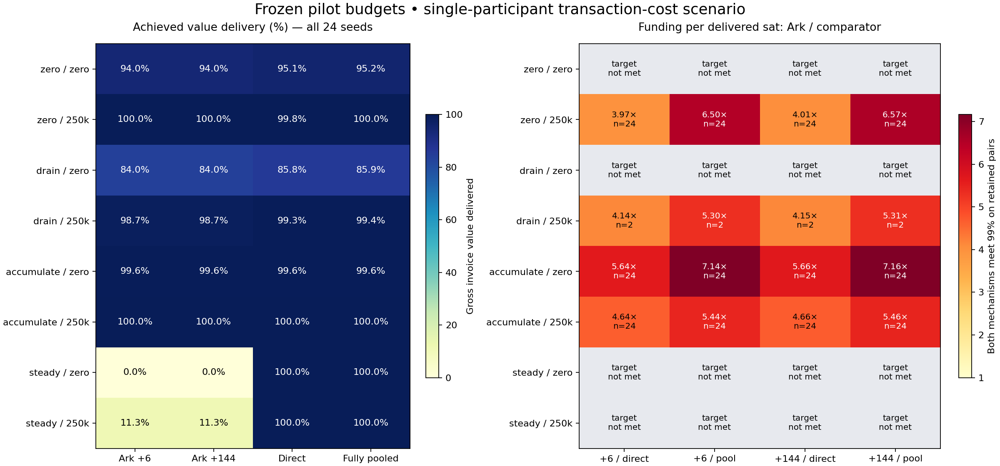

# Frozen-budget, fee-aware forecast results

This is the single-participant transaction scenario defined in [the committed protocol](capital_fixed_budget_protocol.md). It uses disjoint pilot and holdout seeds, the recorded retained-backing semantics, and pinned integer fees. It does not estimate pooled-tree amortization or measured operational latency.

## Service results

All means include 24 holdout seeds. The target is 99% of gross offered value. Funding includes idle wallet, physical roots, and both sides of channels once; holder claims and fronting are overlays.

| Demand | Initial per holder | Recovery delay | Mean delivery | Target passes | Initial funding (sat) | Mean miner fees (sat) |
|---|---:|---:|---:|---:|---:|---:|
| zero | 0 | 6 | 93.97% | 0/24 | 196,698,943 | 124,741,558 |
| zero | 0 | 144 | 93.97% | 0/24 | 197,277,683 | 124,607,148 |
| zero | 250,000 | 6 | 99.97% | 24/24 | 337,110,606 | 218,073,490 |
| zero | 250,000 | 144 | 99.97% | 24/24 | 340,477,697 | 217,867,531 |
| drain | 0 | 6 | 83.98% | 0/24 | 174,993,357 | 115,448,117 |
| drain | 0 | 144 | 83.98% | 0/24 | 175,530,901 | 115,327,412 |
| drain | 250,000 | 6 | 98.74% | 2/24 | 263,436,553 | 162,658,241 |
| drain | 250,000 | 144 | 98.74% | 2/24 | 264,026,270 | 162,517,410 |
| accumulate | 0 | 6 | 99.56% | 24/24 | 636,107,276 | 350,927,309 |
| accumulate | 0 | 144 | 99.56% | 24/24 | 637,821,742 | 350,394,525 |
| accumulate | 250,000 | 6 | 100.00% | 24/24 | 752,976,806 | 406,019,646 |
| accumulate | 250,000 | 144 | 100.00% | 24/24 | 756,031,170 | 405,444,451 |
| steady | 0 | 6 | 0.00% | 0/24 | 17,883 | 0 |
| steady | 0 | 144 | 0.00% | 0/24 | 17,883 | 0 |
| steady | 250,000 | 6 | 11.33% | 0/24 | 5,890,729 | 200,982 |
| steady | 250,000 | 144 | 11.33% | 0/24 | 5,890,729 | 200,982 |

## Channels and pooled groups

Groups share directional capacity but cannot spend other holders' balances. All offered events remain in the denominator.

| Demand | Initial per holder | Group size | Mean delivery | Target passes | Initial funding (sat) |
|---|---:|---:|---:|---:|---:|
| zero | 0 | 1 | 95.07% | 0/24 | 39,851,200 |
| zero | 0 | 5 | 95.16% | 0/24 | 23,590,990 |
| zero | 0 | 20 | 95.19% | 0/24 | 17,824,310 |
| zero | 0 | 200 | 95.19% | 0/24 | 14,604,306 |
| zero | 250,000 | 1 | 99.83% | 24/24 | 84,797,450 |
| zero | 250,000 | 5 | 99.91% | 24/24 | 64,599,740 |
| zero | 250,000 | 20 | 99.96% | 24/24 | 56,428,060 |
| zero | 250,000 | 200 | 99.99% | 24/24 | 51,865,556 |
| drain | 0 | 1 | 85.78% | 0/24 | 22,609,950 |
| drain | 0 | 5 | 85.85% | 0/24 | 10,577,240 |
| drain | 0 | 20 | 85.86% | 0/24 | 6,925,560 |
| drain | 0 | 200 | 85.86% | 0/24 | 4,760,556 |
| drain | 250,000 | 1 | 99.33% | 24/24 | 63,912,450 |
| drain | 250,000 | 5 | 99.41% | 24/24 | 52,848,490 |
| drain | 250,000 | 20 | 99.44% | 24/24 | 50,653,060 |
| drain | 250,000 | 200 | 99.44% | 24/24 | 50,040,556 |
| accumulate | 0 | 1 | 99.57% | 24/24 | 112,784,950 |
| accumulate | 0 | 5 | 99.59% | 24/24 | 97,594,740 |
| accumulate | 0 | 20 | 99.59% | 24/24 | 91,305,560 |
| accumulate | 0 | 200 | 99.59% | 24/24 | 89,080,556 |
| accumulate | 250,000 | 1 | 99.98% | 24/24 | 162,182,450 |
| accumulate | 250,000 | 5 | 100.00% | 24/24 | 146,749,740 |
| accumulate | 250,000 | 20 | 100.00% | 24/24 | 140,384,310 |
| accumulate | 250,000 | 200 | 100.00% | 24/24 | 138,380,556 |
| steady | 0 | 1 | 99.97% | 24/24 | 49,321 |
| steady | 0 | 3 | 99.97% | 24/24 | 17,516 |
| steady | 250,000 | 1 | 100.00% | 24/24 | 798,676 |
| steady | 250,000 | 3 | 100.00% | 24/24 | 766,976 |

## Eligible matched-service ratios

Ratios below divide Ark's fixed funding sat-blocks per delivered sat by the channel/group counterpart on the same seed. A ratio is published only when both meet 99%. Values above one favor the channel/group under this policy. Intervals describe paired-seed variation, conditional on meeting the target; they do not cover transaction-policy uncertainty.

| Demand | Initial | Delay | Group | Both pass | Mean ratio | Bootstrap 95% |
|---|---:|---:|---:|---:|---:|---|
| zero | 0 | 6 | 1 | 0/24 | unavailable | — |
| zero | 0 | 6 | 5 | 0/24 | unavailable | — |
| zero | 0 | 6 | 20 | 0/24 | unavailable | — |
| zero | 0 | 6 | 200 | 0/24 | unavailable | — |
| zero | 0 | 144 | 1 | 0/24 | unavailable | — |
| zero | 0 | 144 | 5 | 0/24 | unavailable | — |
| zero | 0 | 144 | 20 | 0/24 | unavailable | — |
| zero | 0 | 144 | 200 | 0/24 | unavailable | — |
| zero | 250,000 | 6 | 1 | 24/24 | 3.970 | [3.968, 3.972] |
| zero | 250,000 | 6 | 5 | 24/24 | 5.216 | [5.214, 5.217] |
| zero | 250,000 | 6 | 20 | 24/24 | 5.973 | [5.971, 5.976] |
| zero | 250,000 | 6 | 200 | 24/24 | 6.501 | [6.500, 6.502] |
| zero | 250,000 | 144 | 1 | 24/24 | 4.009 | [4.008, 4.011] |
| zero | 250,000 | 144 | 5 | 24/24 | 5.268 | [5.266, 5.269] |
| zero | 250,000 | 144 | 20 | 24/24 | 6.033 | [6.031, 6.035] |
| zero | 250,000 | 144 | 200 | 24/24 | 6.566 | [6.565, 6.567] |
| drain | 0 | 6 | 1 | 0/24 | unavailable | — |
| drain | 0 | 6 | 5 | 0/24 | unavailable | — |
| drain | 0 | 6 | 20 | 0/24 | unavailable | — |
| drain | 0 | 6 | 200 | 0/24 | unavailable | — |
| drain | 0 | 144 | 1 | 0/24 | unavailable | — |
| drain | 0 | 144 | 5 | 0/24 | unavailable | — |
| drain | 0 | 144 | 20 | 0/24 | unavailable | — |
| drain | 0 | 144 | 200 | 0/24 | unavailable | — |
| drain | 250,000 | 6 | 1 | 2/24 | 4.142 | [4.140, 4.143] |
| drain | 250,000 | 6 | 5 | 2/24 | 5.014 | [5.013, 5.014] |
| drain | 250,000 | 6 | 20 | 2/24 | 5.232 | [5.232, 5.233] |
| drain | 250,000 | 6 | 200 | 2/24 | 5.296 | [5.296, 5.297] |
| drain | 250,000 | 144 | 1 | 2/24 | 4.151 | [4.150, 4.152] |
| drain | 250,000 | 144 | 5 | 2/24 | 5.025 | [5.024, 5.026] |
| drain | 250,000 | 144 | 20 | 2/24 | 5.244 | [5.244, 5.244] |
| drain | 250,000 | 144 | 200 | 2/24 | 5.308 | [5.308, 5.309] |
| accumulate | 0 | 6 | 1 | 24/24 | 5.640 | [5.640, 5.641] |
| accumulate | 0 | 6 | 5 | 24/24 | 6.519 | [6.519, 6.520] |
| accumulate | 0 | 6 | 20 | 24/24 | 6.968 | [6.968, 6.969] |
| accumulate | 0 | 6 | 200 | 24/24 | 7.142 | [7.142, 7.143] |
| accumulate | 0 | 144 | 1 | 24/24 | 5.655 | [5.655, 5.656] |
| accumulate | 0 | 144 | 5 | 24/24 | 6.537 | [6.537, 6.537] |
| accumulate | 0 | 144 | 20 | 24/24 | 6.987 | [6.987, 6.987] |
| accumulate | 0 | 144 | 200 | 24/24 | 7.162 | [7.162, 7.162] |
| accumulate | 250,000 | 6 | 1 | 24/24 | 4.642 | [4.641, 4.642] |
| accumulate | 250,000 | 6 | 5 | 24/24 | 5.131 | [5.131, 5.131] |
| accumulate | 250,000 | 6 | 20 | 24/24 | 5.364 | [5.364, 5.364] |
| accumulate | 250,000 | 6 | 200 | 24/24 | 5.441 | [5.441, 5.441] |
| accumulate | 250,000 | 144 | 1 | 24/24 | 4.661 | [4.660, 4.661] |
| accumulate | 250,000 | 144 | 5 | 24/24 | 5.152 | [5.152, 5.152] |
| accumulate | 250,000 | 144 | 20 | 24/24 | 5.385 | [5.385, 5.385] |
| accumulate | 250,000 | 144 | 200 | 24/24 | 5.463 | [5.463, 5.463] |
| steady | 0 | 6 | 1 | 0/24 | unavailable | — |
| steady | 0 | 6 | 3 | 0/24 | unavailable | — |
| steady | 0 | 144 | 1 | 0/24 | unavailable | — |
| steady | 0 | 144 | 3 | 0/24 | unavailable | — |
| steady | 250,000 | 6 | 1 | 0/24 | unavailable | — |
| steady | 250,000 | 6 | 3 | 0/24 | unavailable | — |
| steady | 250,000 | 144 | 1 | 0/24 | unavailable | — |
| steady | 250,000 | 144 | 3 | 0/24 | unavailable | — |

## Audit interpretation

The result JSON files publish exact terminal roots, active/expired claims, exhausted recovery shortfalls, and the future eligible sweep schedule. No obligation disappears at the horizon. Sat-seconds remain null. The instantaneous in-flight integral is a forecast assumption, not a measured duration.

The 100–109-sat steady receipts cannot support the declared fee plus a fresh 330-sat round output. More capital does not repair that policy mismatch. Pooled receipt inventory and batching may produce different results and require their own verified adapter and predeclared campaign.

The single-participant miner costs are material. A broader ranking of Ark versus channels is not justified by this cost scenario alone. The completed live outgoing/recovery/reuse trace supports the capital lock rule; live inbound, failure/revocation, exit, repeated clean restarts and testnet4 clocks remain separate validation work.

The channel opening cost and directional buffers are held at their observed fixture values. They are not a fitted reserve/commitment-fee model for arbitrary channel sizes. Meeting the invoice-delivery target also does not imply immediate spendability of every terminal holder claim; expired claims remain disclosed in the result JSON.
