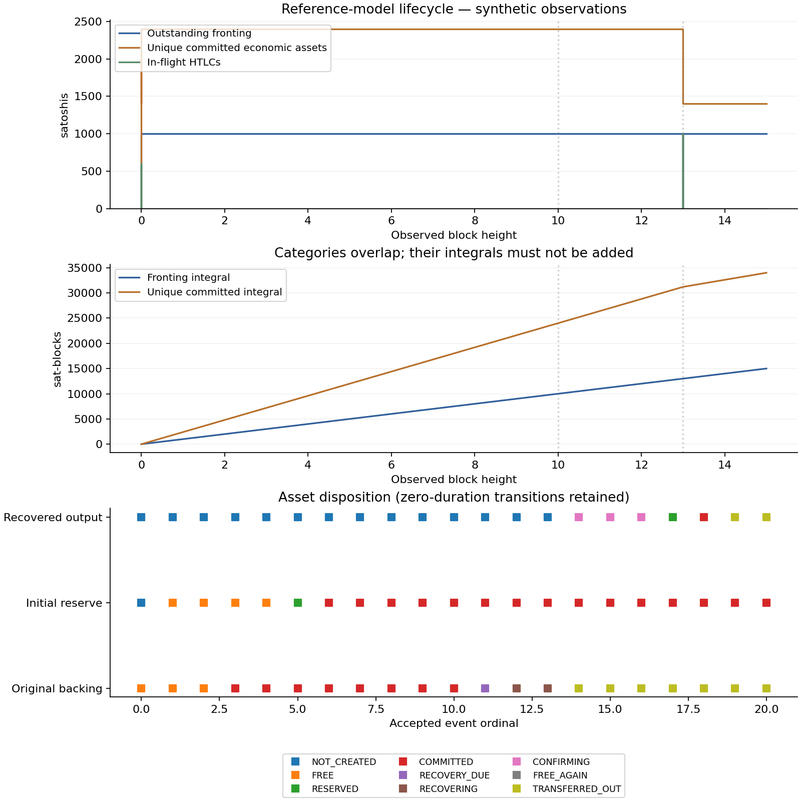
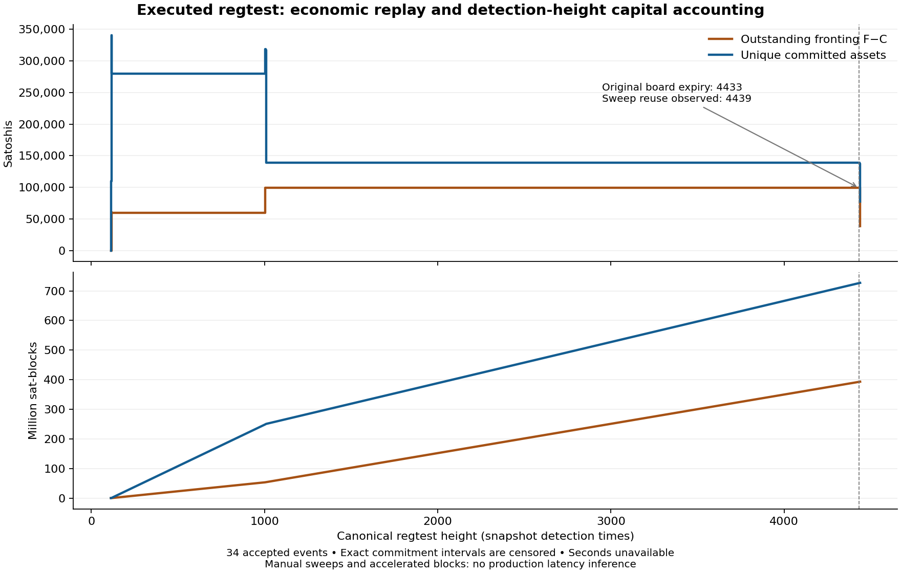

# Capital lifecycle execution report

Date: 2026-10-21. **An owned regtest payment-to-recovery-to-independent-round
lifecycle has now run.** Its full transaction graph balances, and its retained-backing path now passes
34 reducer events with deterministic replay. Precise timing instrumentation and
the implementation-grounded comparison remain unfinished.

## Observed lifecycle

The [runtime manifest](regtest/evidence/runtime-identity.json) pins Bark/captaind/
watchmand 0.7.1 at reported commit `8f5d8c4f4afae87c8e4b3c6fb26fe06e9ae50e6a`,
Core 31.0, CLN 26.06.7, immutable image digests, executable SHA-256 hashes,
actual regtest genesis, commands and redacted configurations. This differs from
the earlier source-only adapter revision. [Runtime source blobs](regtest/evidence/runtime-source.json)
are recorded separately; a reported build commit is not a reproducible-build attestation.

| Observed step | Result |
|---|---|
| Board at height 113 | 100,000-sat output; 99,670-sat client claim; 330-sat board fee |
| Outgoing payment at 116 | 60,000 sats delivered; zero routing fee; 555-sat retained service fee |
| Surviving change | 39,115 sats, still anchored to the original board |
| Refresh at 1000 | 38,652-sat replacement claim expiring at 5320; 463-sat service fee |
| Original-board expiry | Height 4433; not treated as available reserve |
| Manual sweep | 100,000-sat sole input; 98,705-sat output; 1,295-sat miner fee |
| Confirmed recovery at 4436 | Recovered output is the server wallet's sole UTXO and entire balance |
| Independent new round | Sole input is that recovered output; three confirmations at 4439 |

[reuse-proof.json](regtest/evidence/reuse-proof.json) binds the original board,
sweep and new round by actual transaction outpoints. No external top-up occurred
between recovery and reuse. Earlier pool assets were swept separately, automatic
pool replenishment was explicitly disabled, and unrelated free reserve was moved
to an owned quarantine address before original expiry. Those interventions are
recorded; this is an isolated feasibility experiment, not an unattended production run.
Timelocks retained source defaults. Blocks were accelerated and sweeps manually
triggered, so these elapsed wall times cannot calibrate testnet4 operational clocks.

The [independent transaction audit](regtest/evidence/economic-reconciliation.json)
checks conservation at every onchain transaction, all remaining leaves against
Core's UTXO set, active claim backing, and channel shares without counting their
funding output twice:

`2,200,000 = 2,027,378 operator + 99,845 client onchain + 60,000 recipient + 12,777 miner fees`.

The final 38,347-sat client claim overlays operator-held backing and is not an
additional economic asset. Five adversarial offline checks reject altered UTXO
values, missing ancestry, channel double counting and unbacked claims.

This run exposes a required model correction: outgoing change can retain its old
backing. The abstract fresh-change case is not a universal Bark rule. The refresh
also creates a 330-sat additional backing component and pays distinct miner fees;
equating gross reserve with either the invoice or the forfeited claim is inadequate.

## What was executed

The implementation branch starts at Spiral
`23155003010310c3a5c41b9ab8f3db910e69bc3e` on
`review/bitcoin-peer-review-2026-10-21`. Node v24.19.0 executes the TypeScript
reference model with built-in type stripping. Strict static checking uses
TypeScript 5.9.3. Figures use Python 3.12 and Matplotlib 3.10.7. The new reducer
adds no runtime package dependency to Spiral.

The [synthetic event journal](capital/lifecycle.jsonl) records one complete
funded-to-recovered-to-reused model lifecycle. Its hash/check result and terminal
state are in [lifecycle-check.json](capital/lifecycle-check.json) and
[lifecycle-summary.json](capital/lifecycle-summary.json).

| Quantity at height 15 | Satoshis |
|---|---:|
| Initial/external funding: original backing + reserve + second claim backing | 3,000 |
| Delivered outward payments: 600 + 1,000 | 1,600 |
| Remaining economic assets: change backing + second payment recovery backing | 1,400 |
| External fees/losses in this zero-fee fixture | 0 |
| Original dedicated reserve budget | 1,000 |
| Cumulative gross fronting F | 2,000 |
| Proven reference-model recovery C | 1,000 |
| Outstanding second front W, still censored | 1,000 |

The 600-sat payment forfeits a 1,000-sat input and creates a 400-sat claim on the
fresh reserve's remaining economic balance. The original 1,000-sat backing stays
locked through expiry at height 10. Sweep inclusion is observed at 11; the
fixture's new funding transaction is included at 12; its independent reservation
is admitted at 13 with two confirmations. That second operation names the
recovered output and successfully settles without new external funding between
recovery and reuse. The second client's backing existed before recovery and was
never counted as free reserve.

Both offered and delivered value are 1,600 sats (100% delivery in this tiny
fixture). Fronting integrates to 15,000 sat-blocks and 9,000,000 sat-seconds.
Unique committed owned assets integrate to 34,000 sat-blocks and 20,400,000
sat-seconds. The corresponding durations are 9.375 and 21.25 blocks over either
denominator. These categories overlap and must not be added. Immediate
acceptance/settlement in this fixture creates zero-duration HTLC exposure;
that is a modeling choice, not a latency observation.

The ten requested deterministic cases are named in `model/capital.test.ts`.
Additional tests cover schema rejection, duplicate event identity, sub-satoshi
fees, source-pin mismatch, late settlement after failure, channel accounting,
oracle checkpoints, timestamps, deep-reorg halting and demand denominators.
Randomized stateful testing checks 4,096 generated commands and supplies a
deletion shrinker for counterexamples. See [verification.json](capital/verification.json)
for the completed run's counts, commands and code hashes.

## Runtime failures preserved

A task-local Docker daemon was provisioned in WSL. The pinned server rejected
Core 30 despite its Compose example naming that version; the executed fixture
uses Core 31. An initial temporary fixture was lost on a WSL restart. The retained
fixture uses `/var/tmp/spiral-capital-runtime`, loopback ports and resource limits.

Docker's initial VFS storage exhausted host disk space. Its 8.2-GB disposable
cache was removed while preserving wallets and DBs, then rebuilt using overlay2.
Host-space guards now check Windows free space, not just WSL's virtual capacity.
After the interruption, Core's index showed 101 while Bark retained 113 and
panicked. Reindexing existing block files restored the exact original height-113
hash. [The recorded mismatch](regtest/evidence/disk-full-chain-interruption.json)
occurred before the Bark payment and is not presented as a successful reorg test.

Bark's send command returned success with empty stdout; an initial JSON parser
treated that as uncertain failure. The action was not repeated. DB settlement
proof and CLN `listpays` reconciled the successful payment. The failed local action
record is preserved alongside the authoritative observation.

## Remaining acceptance work

The [accepted journal](regtest/evidence/lifecycle-observed.jsonl) and
[machine reconciliation](regtest/evidence/machine-reconciliation.json) preserve
all final economic assets and the 38,347-sat active claim. F=138,158, C=99,204,
W=38,954 sats: 38,677 sats of new round fronting plus a 277-sat exhausted-backing
shortfall. C includes the 499-sat unused routing limit and 98,705-sat recovered
board. This explicitly counts full round roots, including their 330-sat overhead.

Capture exact acceptance and commitment times before interpreting the
detection-height capital-time trace as a latency measurement. The recorded
HTLC acceptance is reconstructed from proved settlement and pinned control flow;
its timestamp was not sampled. All second-based integrals are unavailable.

The subsequent [failure report](capital_failure_report.md) verifies accepted
outbound failure and cooperative revocation, including replacement claim
ancestry and one pending-channel snapshot. Live timeout/unilateral recovery,
receive, exit and reorg branches remain distinct validation work.

The [fee-aware fixed-budget comparison](capital_fixed_budget_results.md) now
reruns all four demand families under retained backing and declared recovery
delays, with fees, round overhead, disjoint pilot/holdout seeds and both initial
balance factors. The protocol and budgets were committed before holdout
evaluation. All 384 Ark and 672 channel/group forecasts are retained, including
target failures and terminal obligations. This is a conditional single-participant
transaction-cost scenario, not a measured deployment ranking or batched-receipt
cost estimate. The [status artifact](capital/matched-service-status.json) keeps
that distinction explicit.

The [live-branch preflight](regtest/evidence/live-branch-preflight.json) verifies
that the current owned CLN node lacks the hold-invoice plugin required by the
pinned inbound path. Exact operational timing, those additional live paths,
bounded testnet4 clocks, and patched-local BIP 448/LayerTree experiments remain
unfinished. No testnet4 experiment was attempted; a synchronized endpoint and
dedicated test funding were requested.
