# Proof admission, delegation and settlement

The default proof service uses Python’s standard library, SQLite, a static UI and a separately pinned verifier. The Cashu extension adds a pinned SDK client, an encrypted local wallet vault and a provider issuance bridge. The desk stores blinded requests; it does not receive wallet private keys or bearer proofs.

```mermaid
flowchart LR
  Proof[M16 statement + final proof] --> Gate[Pinned kan-payment-gate]
  Policy[Immutable intent + registered script + verifier pins] --> Gate
  Gate --> Bind[Cross-check PAY1 payment]
  Core[Local Bitcoin Core active chain] --> Bind
  Bind --> Journal[Atomic intent and outpoint reservation]
  Journal --> Outbox[Prepared settlement request]
  Outbox --> Quote[Wallet-owned Cashu quote + signed request]
  Quote --> CDK[CDK blind issuance / NUT-09 restore]
  CDK --> Wallet[Wallet unblinds and verifies DLEQ]
  Wallet --> Melt[Reserved Cashu inputs and saved change secrets]
  Melt --> Arkoor[Custom arkoor melt]
  Arkoor --> Recipient[Recipient Bark validates received VTXOs]
  Recipient --> Planner
  Chain[Chain height + validated VTXO data] --> Planner[Refresh / exit plan]
  Planner --> Bark[Bark signs delegated refresh or exit data]
  Bark --> Saved[Private immutable exit package]
  Saved --> Watch[Independent Core-only regtest watcher]
  Watch --> Exit[Observe exit waves and claim timelock]
  Exit --> Owner[Owner signs final claim]
```

## State and trust

| Object | Established here | Still external |
| --- | --- | --- |
| Parsed M16 statement | Byte layout, lengths, encoding, hashes, basic consistency | Proof validity |
| Verified payment evidence | Pinned native verifier accepted the exact statement and matching payment fields | Verifier/circuit correctness, current chain choice |
| Active-chain observation | Synced configured Core reports both proof tip and payment block active, tip unchanged during observation | Correct Core node, future reorganizations |
| Prepared outbox | Payment matches fixed intent, script, amount, policy and local namespace; one atomic reservation | Issuance, spending, reserves, redemption |
| Cashu quote / Bark movement | Provider reported that response | Cryptographic validity and final settlement |
| Reconciled Cashu melt | Original inputs spent, change DLEQ and unspent states checked, saved fee budget satisfied | Mint honesty and independently validated recipient payment |
| VTXO plan | Decision under supplied heights, validation flag and safety budget | Exit package validity, signatures, broadcasting, fee adequacy |
| Saved exit package | Core-decoded identities, anchor ancestry, exact fee budget and wave dependencies | Funds can be spent elsewhere; future mempool eligibility and confirmation |
| Exit wave observation | Core admits the combined signed package and later reports active-chain confirmations | Future reorgs, fee-market liveness and timely owner claim |
| Public archive CID | Exact byte identity of redacted JSON | Storage, retrieval, Filecoin deal acceptance, validity of claims inside |

## Why unique scripts matter

A public payment proof identifies an output, not a rightful claimant to an arbitrary application intent. Two recipients sharing the same deposit script and amount could race to claim a copied proof. The registry therefore forbids reassigning `(network, script_sha256)` to any second intent. Intent IDs cannot change their recipient, amount, network, script, rail or expiry. The configured receiving wallet must generate and control these scripts; registration alone does not establish control.

The ledger separately enforces unique `(network, outpoint)` and unique `intent_id` in claims and outbox. One `BEGIN IMMEDIATE` transaction records both. An exact repeated submission produces the original deterministic request ID; a different payment cannot reuse the intent. Validation happens before reservation, including on a retry. After expiry or a reorg, use the receipt query to inspect an old reservation rather than treating a retry as new authorization.

The local administrator can edit the code, policy or database. This is automation under an explicit trust boundary, not an adminless mint. There is no claim of proof-of-reserves, consensus enforcement, unspentness, guaranteed Ark recovery or a deployed BitVM bridge.

The desk gates its own issuance forwarding. CDK remains a separate mint service;
direct requests to it are governed by CDK's paid-quote rules, not the desk's M16
admission policy. Enforcing a ZK policy inside mint custody would require a mint
integration or an independently enforced settlement construction. The current
reduction in ongoing mint trust comes from redeeming into the owner's Ark wallet,
then validating a refresh successor and retaining independent exit data.

## Execution and remaining integrations

Cashu issuance is now implemented for locked on-chain quotes. Registration is signed by the quote key, and the immutable intent binds the provider, request script, amount and beneficiary key. Issuance additionally needs an application-domain signature over its complete public packet. Only the original blinded outputs can be retried or restored. Secrets and blinding factors are committed in the encrypted wallet before the desk is called. The tested target is CDK 0.18.3 and SDK 4.13.1; the mint validates the SDK's amended NUT-20 wire format.

The provider's payment expiry is distinct from the desk's seven-day proof-admission window, because proofs can be expensive to produce. Mint accounting still determines whether a payment was eligible under the provider's detection deadline; this timing fact is not established by inclusion alone. An already admitted payment remains issuable after either deadline, with fresh chain checks.

The actual regtest test restores a lost successful response and verifies spendable proofs, with one mint request. The production M16 verifier was tested separately against a historical mainnet proof. These are independent evidence scopes, not a claim that the full mainnet deposit-to-Cashu path was exercised.

The regtest Cashu withdrawal binds destination, mint, source balance, network profile, amount and fee limit to a saved quote. It commits selected input proofs and change secrets before dispatch and reserves the balance until reconciliation. An uncertain melt is never automatically resent. Paid-quote reconciliation checks spent inputs, exact saved change outputs, DLEQ signatures and actual fees before replacing proofs. The mint's payment identifier remains an operator receipt. Recipient Bark VTXOs and a Core-confirmed refresh successor establish a separate evidence stage. A local SQLite transaction cannot make a remote wallet action atomic. See [withdrawal workflow](cashu-ark-withdrawal.md).

Recheck the active chain before executing. Verify mint signatures through a maintained Cashu wallet library and observe the provider’s terminal result. For Ark, validate full VTXO/transaction lineage with Bark, record successor receipts and retain old exit data until replacement is established. Never infer an Ark-native transfer from an on-chain M16 proof: it proves a different statement.

The independent exit watcher is implemented for regtest. It loads a private, owner-authenticated bundle and Core configuration without a Bark endpoint or wallet keys. It checks current inputs, submits only saved signed bytes, reconciles exact transaction IDs after a lost reply, waits for every wave's confirmations and the claim delta, and detects reorgs. Immutable transaction decoding/fee arithmetic is cached within a watcher process; input availability, active-chain confirmations and mempool eligibility are always freshly observed. Core's combined package submission performs the definitive signature/policy checks when a zero-fee parent's dry-run cannot establish them. See [recovery workflow](ark-recovery.md).

For Filecoin, ingest the exported raw block with the exact CID or package it into a verified CAR, create an authorized deal, and check storage/retrieval evidence. A URL, CID or uploaded receipt cannot certify reserve solvency. Keep beneficiaries, quote IDs, bearer tokens and Cashu bearer secrets out of public evidence.

For p2poolv2, independently authenticate payout provenance and prove the actual coinbase/payment output with its applicable maturity requirements. A share receipt or reported balance is not Bitcoin payment evidence. The generic payment contract is reusable but there is no direct pool adapter or coinbase-maturity policy in this build.
